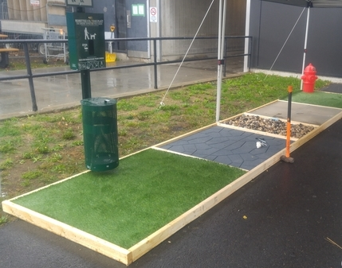

I've done user research for all sorts of clients. Super technical clients, clients who hate technology, the elderly, the youth, and so many people in between.

But this particular day, we were doing UX research for dogs. 

## As always ... why?
I should note that VIA really does strive to make customer experience seamless and memorable for each and every single person who enters their stations or boards their trains. However, one area where VIA (and other transportation companies) have fallen short is when it comes to their disabled or limited-mobility customers. 

Often, low-vision, limited-mobility or disabled customers will have a service animal accompanying them on their VIA trip. However, while there are bathrooms for the customer, there is little to nothing for their animal companions. And they need to go too! So, VIA decided to implement service animal relief areas (SARA, for short) in stations across the country. However, the exact design of these relief areas was something that was still TBD. That's where our team came in!

## The Plan
This was in the works before we had even started interning at VIA. One of my bosses had already commissioned the construction of these so-called relief areas. However, he had asked that each separate 'area' be made of a different type of material in order to figure out what may be most suitable. The plan was to test these relief areas at the Ottawa station, which was already the site for a meeting with the Canadian Society for the Blind.

Although it was only our 2nd week at the company, our bosses figured this was a great learning opportunity and had us take the train down to Ottawa with them to attend this meeting. They suggested that we really pay attention to the customers and their companion animals. 

After all, none of us had ever really designed for a user that wasn't able-bodied. And this is a whole issue by itself - the fact that our design courses and methodologies almost always account for the 'general' user is probably something that deserves its own blog post. But, I digress. Truth is, we had never placed these customers at the forefront of our minds. And this trip was going to help us fix that. 

## Testing?
The customers who were part of the council knew that we were going to discuss relief areas for their companion animals, but they didn't know that there were actual relief areas set up outside. 

Here's the set up. 

Our options consisted of foam, pebbles, sand, artificial grass and slightly less artificial grass. We just needed to figure out which of these materials would be best for a dog to use. 

Now, we couldn't really do things using the classic focus group, or with a little A/B testing as our primary users were ... dogs. So, we waited. We literally waited for the dogs to 'go'. 

I think we stood there waiting for about half an hour - mind you, this was a very eventful half hour as our 6 high-energy clients were very interested in all aspects of the set-up. Almost all of them enjoyed playing on the pebble area, though the sand area was not a favourite among any. The foam area was one dog's comfort zone, whereas others could not have cared less. But keep in mind - this was all while they were playing. When it came time for them to 'go', they only used the two types of grass. Only 4 out of the 6 dogs ended up 'going', but I suppose this was as conclusive of a result as we could get. 

## Lessons Learned
I think there were a couple solid takeaways from this trip. While we figured out the type of material that is best suited for a dog who wants to take care of its business, we also realized that some of the design choices we made weren't doing wonders for the dogs' owners. For example, if you look at the picture shown above, the garbage can for waste disposal is placed at the back of the relief area. To a person without any vision impairment or accessibility issues, that may not be a big deal - they can just reach over and drop their garbage into the bin. But, for our vision-impaired customers or our wheelchair users, both seeing and making use of this disposal becomes a challenge. 

With the help of this session, important considerations such as these were noted. And now, we take all of this information back with us to Montreal as we further refine the set-up in preparation for a (hopefully) smooth rollout of these relief areas across the country!

